# Unitree RL Mjlab


## ✳️ Overview
Unitree RL Mjlab is a reinforcement learning project built upon the
[mjlab](https://github.com/mujocolab/mjlab.git), using MuJoCo as its 
physics simulation backend, currently supporting Unitree Go2, A2, As2, B2, the
wheel-legged Go2-W, As2-W and B2-W, G1, R1, H1_2 and H2.

Mjlab combines [Isaac Lab](https://github.com/isaac-sim/IsaacLab)'s proven API
with best-in-class [MuJoCo](https://github.com/google-deepmind/mujoco_warp)
physics to provide lightweight, modular abstractions for RL robotics research
and sim-to-real deployment.

<div align="center">

| <div align="center">  MuJoCo </div>                                                                                                                                           | <div align="center"> Physical </div>                                                                                                                                               |
|-------------------------------------------------------------------------------------------------------------------------------------------------------------------------------|------------------------------------------------------------------------------------------------------------------------------------------------------------------------------------|
| <div style="width:250px; height:150px; overflow:hidden;"></div> | <div style="width:250px; height:150px; overflow:hidden;"></div> |

</div>


## 🦿 Quadruped Locomotion: Depth Students and Blind Policies

Joystick velocity policies for Go2, As2, B2 and the wheel-legged Go2-W, As2-W and B2-W
that walk in every direction on flat ground and climb stairs (risers up to 18 cm),
deployed on the robots' Jetson and in [tinynav-sim](https://github.com/Jiajun-Li-deepmirror/tinynav-sim).
Each robot runs two policies:

- **depth student** (default): proprioception plus the navcore depth camera on the
  head (2 x 80 x 68 frames), distilled from a scan-based teacher and PPO-fine-tuned;
- **blind policy** (fallback): IMU, joint states, the command and a heading error
  only. The controller hands over to it while the depth frame is untrustworthy
  (no frame, stale, something filling the view up close).

The wheel-legged robots drive on all four wheels and step only to turn, move sideways
or climb.

### Deployed models (2026-11-10)

| Robot | Depth student | Blind policy | Payload in training |
|---|---|---|---|
| Go2 | `depth_v3_fe` (10-31) | `blind_v4` = feetedge polish 10000 (10-31) | no (base mass noise only) |
| As2 | `depth_v3_fe` (10-31) | `blind_v3` = feetedge polish 12000 (10-31) | no |
| B2 | `depth_v4_n4b` (11-09) | `blind_v3` = blind chain l10, P 11800-12300 average (11-09) | up to 40 kg |
| Go2-W | `depth_v6_w27d` (11-09) | `blind_v3` = blind chain g27b 19800 (11-09) | up to 12 kg |
| As2-W | `depth_v6_mg4` (11-10) | `blind_v3` = blind chain mixfg 11000 (11-10) | up to 13 kg |
| B2-W | `depth_v7_ew` (11-05) | `blind_v2` = polish 9000 (11-01) | no (base mass -5..+10 kg) |

In training now: Go2 and As2 blind policies with the payload (blind chain M phase,
then the depth chain); B2-W follows.

**Payload.** `mdp.base_payload_point` puts a point mass on the base at every reset
(mass, centre of mass and inertia of the base): half the robots in the light range,
half uniform up to the robot's documented limit, at a point within ±0.15 m forward,
±0.08 m sideways and 0..0.20 m up (B2 / B2-W ±0.30 / ±0.15 / 0..0.30 m).
`standpose` (`mdp.standing_pose_load`) charges the legs' distance from the default
stance once the robot has come to rest, weighted by the payload.

### Training pipeline

All training runs on the GPU boxes from `jobs/` (paths under
`/root/gpufree-data/go2-depth/depth_fe`); per-robot settings in `jobs/fe_robot.sh`
and `jobs/v2_robot.sh`.

1. **Blind chain** (`jobs/blind_chain.sh R TAG`): T = `Unitree-<R>-Blind-Teacher` from
   scratch on flat ground, M = `-Blind-Mixed` (stairs ramped in, payload),
   P = `-Blind-Polish`; each phase stops at its first checkpoint (average of the last
   8) that passes the acceptance. Recipe keys come in `BLIND_PILOT`
   (`src/tasks/velocity/blind_env_cfg.py`). The package goes to `logs/pkg/<r>_bl2_<TAG>_<K>`.
2. **Depth chain** (`jobs/fe_chain.sh`, `jobs/v2_chain.sh`): a scan teacher fine-tuned
   from the blind package, a depth student distilled from it (stage 1) and
   PPO-fine-tuned with behaviour cloning (stage 2), exported to ONNX for the Jetson
   and tinynav-sim.
3. **Acceptance** (`jobs/fe_check.sh`, `scripts/blind/acceptance`, `scripts/blind/eval`):
   flat commands in every direction, stops and creep, standing with the payload,
   alternating turns, map3 stairwell flights, three seeds; then tinynav-sim (map3 and
   the pyramid scene: riser kicks, slide-back, idle steps, roll, falls, with and
   without the payload limit).

Acceptance clips of the 10-21 blind finals (flat ground, map3 stairwell tour, 4x speed):

| Robot | Flat ground | map3 stairwell tour |
|---|---|---|
| Go2 | 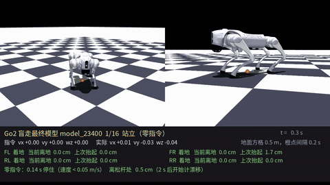 | 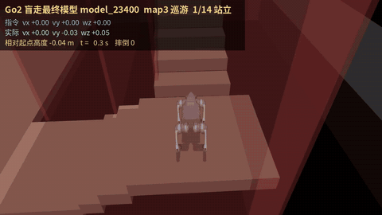 |
| As2 | 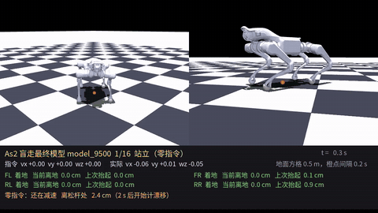 | 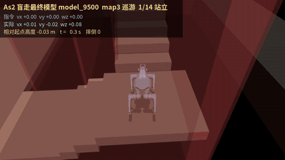 |
| B2 | 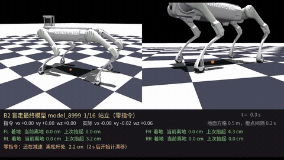 | 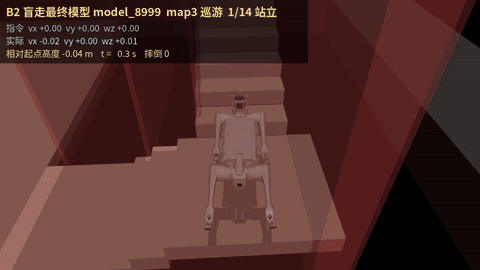 |
| Go2W | 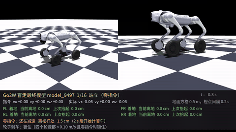 | 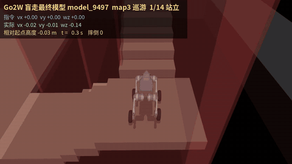 |
| As2W | 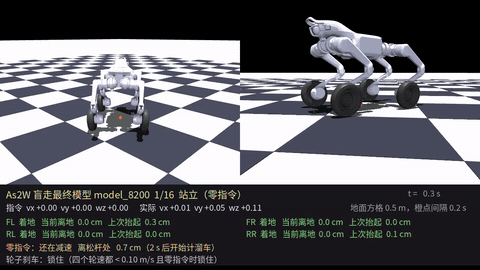 | 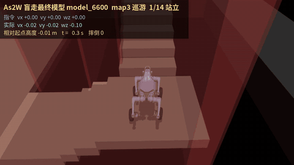 |
| B2W | 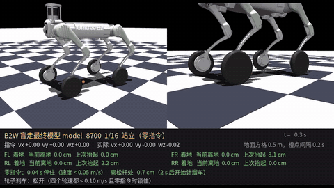 | 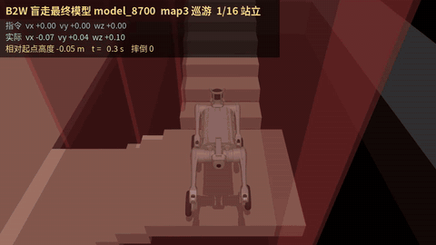 |

### Deployment

`deploy/robots/<robot>` holds the Unitree-style controllers for the six quadrupeds
(wheel brake, march in place, thermal guard, heading input). The controllers that run
on the robots' Jetson (`./run.sh <robot>`: depth student with blind fallback, wall
guard, thermal guard with the posture reset, full logging) are kept in a separate
`robot_ctrl` tree, not in this repository.

## 💃 G1 Motion Tracking (Dance)

`src/tasks/tracking` trains G1 / G1-23dof motion imitation, including the
`Unitree-G1-Tracking-Tight-Legs` task and its `-Latency<ms>` variants; the G1
controller (`deploy/robots/g1`) adds a fall guard (`deploy/include/FallGuard.h`:
torso / pelvis tilt, joint error and speed limits switch to Passive) and Dance1-3
states. See section 2 below for the motion files and training commands.


## 📦 Installation and Configuration

Please refer to [setup.md](doc/setup_en.md) for installation and configuration steps.


## 🔁 Process Overview

The basic workflow for using reinforcement learning to achieve motion control is:

`Train` → `Play` → `Sim2Real`

- **Train**: The agent interacts with the MuJoCo simulation and optimizes policies through reward maximization.
- **Play**: Replay trained policies to verify expected behavior.
- **Sim2Real**: Deploy trained policies to physical Unitree robots for real-world execution.


## 🛠️ Usage Guide

### 1. Velocity Tracking Training

Run the following command to train a velocity tracking policy:

```bash
python scripts/train.py Unitree-G1-Flat --env.scene.num-envs=4096
```

Multi-GPU Training: Scale to multiple GPUs using --gpu-ids:

```bash
python scripts/train.py Unitree-G1-Flat \
  --gpu-ids 0 1 \
  --env.scene.num-envs=4096
```

- The first argument (e.g., Mjlab-Velocity-Flat-Unitree-G1) specifies the training task.
Available velocity tracking tasks:
  - Unitree-Go2-Flat
  - Unitree-G1-Flat
  - Unitree-G1-23Dof-Flat
  - Unitree-H1_2-Flat
  - Unitree-A2-Flat
  - Unitree-R1-Flat
  - Unitree-Go2-Blind: proprioception-only Go2 for joystick control and stairs up to 18 cm;
    see [doc/go2_blind.md](doc/go2_blind.md) for its training recipe, evaluation and deployment.

> [!NOTE]
> For more details, refer to the mjlab documentation:
> [mjlab documentation](https://mujocolab.github.io/mjlab/index.html).

### 2. Motion Imitation Training

Train a Unitree G1 to mimic reference motion sequences.

<div style="margin-left: 20px;">

#### 2.1 Prepare Motion Files

Prepare csv motion files in mjlab/motions/g1/ and convert them to npz format:

```bash
python scripts/csv_to_npz.py \
--input-file src/assets/motions/g1/dance1_subject2.csv \
--output-name dance1_subject2.npz \
--input-fps 30 \
--output-fps 50 \
--robot g1 # g1 or g1_23dof
```

**npz files will be stored at:**：`src/motions/g1/...`

#### 2.2 Training

After generating the NPZ file, launch imitation training:

```bash
python scripts/train.py Unitree-G1-Tracking-No-State-Estimation --motion_file=src/assets/motions/g1/dance1_subject2.npz --env.scene.num-envs=4096
```

Available tasks:
  - Unitree-G1-Tracking-No-State-Estimation
  - Unitree-G1-23Dof-Tracking-No-State-Estimation

</div>

> [!NOTE]
> For detailed motion imitation instructions, refer to the BeyondMimic documentation:
> [BeyondMimic documentation](https://github.com/HybridRobotics/whole_body_tracking/blob/main/README.md#motion-preprocessing--registry-setup).

#### ⚙️  Parameter Description
- `--env.scene`: simulation scene configuration (e.g., num_envs, dt, ground type, gravity, disturbances)
- `--env.observations`: observation space configuration (e.g., joint state, IMU, commands, etc.)
- `--env.rewards`: reward terms used for policy optimization
- `--env.commands`: task commands (e.g., velocity, pose, or motion targets)
- `--env.terminations`: termination conditions for each episode
- `--agent.seed`: random seed for reproducibility
- `--agent.resume`: resume from the last saved checkpoint when enabled
- `--agent.policy`: policy network architecture configuration
- `--agent.algorithm`: reinforcement learning algorithm configuration (PPO, hyperparameters, etc.)

**Training results are stored at**：`logs/rsl_rl/<robot>_(velocity | tracking)/<date_time>/model_<iteration>.pt`

### 3. Simulation Validation

To visualize policy behavior in MuJoCo:

Velocity tracking:
```bash
python scripts/play.py Unitree-G1-Flat --checkpoint_file=logs/rsl_rl/g1_velocity/2026-xx-xx_xx-xx-xx/model_xx.pt
```

Motion imitation:
```bash
python scripts/play.py Unitree-G1-Tracking-No-State-Estimation --motion_file=src/assets/motions/g1/dance1_subject2.npz --checkpoint_file=logs/rsl_rl/g1_tracking/2026-xx-xx_xx-xx-xx/model_xx.pt
```

**Note**：

- During training, policy.onnx and policy.onnx.data are also exported for deployment onto physical robots.

**Visualization**：

| Go2                              | G1                             | H1_2                               | G1_mimic                          |
|----------------------------------|--------------------------------|------------------------------------|-----------------------------------|
|  |  |  |  |

### 4. Real Deployment

Before deployment, install the required communication tools:
- [cyclonedds](https://github.com/eclipse-cyclonedds/cyclonedds.git)
- [unitree_sdk2](https://github.com/unitreerobotics/unitree_sdk2.git)

<div style="margin-left: 20px;">

#### 4.1 Power On the Robot
Start the robot in suspended state and wait until it enters `zero-torque` mode.

#### 4.2 Enable Debug Mode
While in `zero-torque` mode, press `L2 + R2` on the controller. The robot will enter `debug mode` with joint damping enabled.

#### 4.3 Connect to the Robot
Connect your PC to the robot via Ethernet. Configure the network as:
- Address：`192.168.123.222`
- Netmask：`255.255.255.0`

Use `ifconfig` to determine the Ethernet device name for deployment.

#### 4.4 Compilation

Example: Unitree G1 velocity control.
Place `policy.onnx` and `policy.onnx.data` into: `deploy/robots/g1/config/policy/velocity/v0/exported`.
Then compile:

```bash
cd deploy/robots/g1
mkdir build && cd build
cmake .. && make
```

#### 4.5 Deployment

## 4.5.1 Simulation Deployment

Before deploying on the real robot, it is recommended to perform simulation deployment using [unitree_mujoco](https://github.com/unitreerobotics/unitree_mujoco)
to prevent abnormal behaviors on the physical robot. This framework has already integrated it.

Build unitree_mujoco：

```bash
cd simulate
mkdir build && cd build
cmake .. && make -j8
```

Launch the simulator (note that a gamepad must be connected):

```bash
./simulate/build/unitree_mujoco
```

You can select the corresponding robot in `simulate/config`

Launch the simulation control program:

```bash
cd deploy/robots/g1/build
./g1_ctrl --network=lo
```

## 4.5.2 Real-Robot Deployment

Launch the control program on the real robot:

```bash
cd deploy/robots/g1/build
./g1_ctrl --network=enp5s0
```

**Arguments**：
- `network`: The network interface used to connect to the robot. Use `lo` for simulation deployment, and `enp5s0` for the real robot(You can check it using the `ifconfig` command) 

</div>

**Deployment Results**：

| Go2                                                    | G1                                                    | H1_2           | G1_mimic                                           |
|--------------------------------------------------------|-------------------------------------------------------|----------------|----------------------------------------------------|
|  |  |  |  |


## 🎉  Acknowledgements

This project would not be possible without the contributions of the following repositories:

- [mjlab](https://github.com/mujocolab/mjlab.git): training and execution framework
- [whole_body_tracking](https://github.com/HybridRobotics/whole_body_tracking.git): versatile humanoid motion tracking framework
- [rsl_rl](https://github.com/leggedrobotics/rsl_rl.git): reinforcement learning algorithm implementation
- [mujoco_warp](https://github.com/google-deepmind/mujoco_warp.git): GPU-accelerated rendering and simulation interface
- [mujoco](https://github.com/google-deepmind/mujoco.git): high-fidelity rigid-body physics engine
